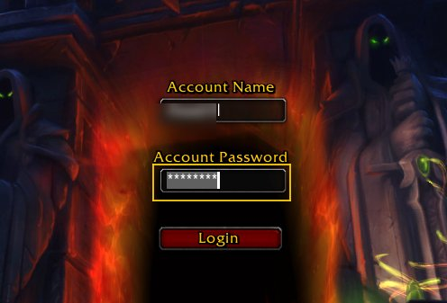
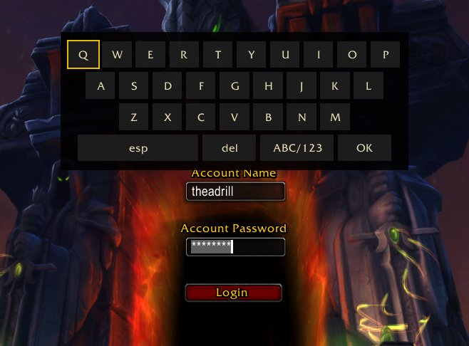
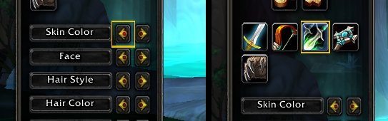
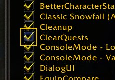
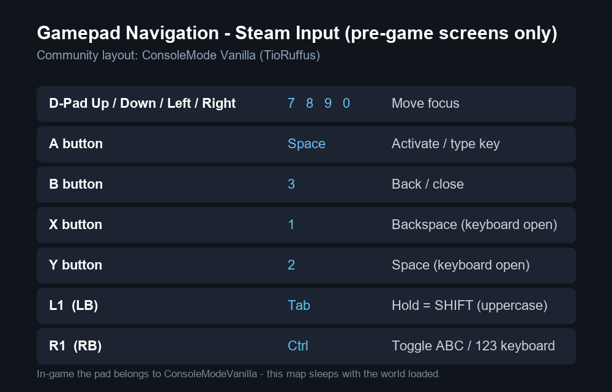

# GluePad — Full gamepad navigation for the WoW 1.12 pre-game screens

Drive the login, character select, realm list, character creation, addons
and dialogs with a gamepad only: D-pad moves focus, **A** activates,
**B** steps back — from boot to "Enter World", no mouse, no keyboard.
In-game the DLL goes fully silent (the ConsoleModeVanilla addon owns
the pad there).

## Quick install

1. You need: **WoW 1.12.1 (build 5875)** started through the
   **VanillaFixes loader** (`VanillaFixes.exe` + `dlls.txt`), and
   **ClassicAPI.dll ≥ 1.15.16** (the `RunScript` bridge into the glue).
2. Close the game, run `build.bat` (MinGW-w64 i686, no admin — it
   compiles and auto-installs), or copy the DLL manually to
   `<game>\mods\GluePad.dll`.
3. Make sure `dlls.txt` (plain LF) contains these two lines
   (anything else in there belongs to your own setup — GluePad only
   needs these):

```text
ClassicAPI.dll
mods/GluePad.dll
```

4. Launch via `VanillaFixes.exe` and drive with the pad.

## Features

**1. Full gamepad navigation on the start screens.**
D-pad moves the native Vanilla focus (blue `LockHighlight` / editbox
caret), A clicks, B steps back. Zero custom textures, zero floating
cursors.



**2. A 100% working virtual keyboard.**
QWERTY + 123/symbols grid anchored above the focused field. Hold **LB**
for SHIFT (letters grow while armed), **RB** toggles the layout,
**X** = backspace, **Y** = space. Types username, password and
character names pad-only — typed text is never logged.

[](docs/img/2-keyboard-full.jpg)

*(click to enlarge)*

**3. Every major screen.**
Login, character select, realm list, character creation, addon list and
pop-up dialogs — discovered at runtime, so custom-glue updates can't
break it.



**4. Real navigation, really.**
Spatial D-pad (it goes where you point, no wrap), hold-to-repeat, a gold
ring following focus, and Steam Input doubles swallowed in the glue.



## Controls

| Pad | Action |
|---|---|
| D-pad (hold repeats) | Move focus (spatial — no wrap) |
| A | Activate button / focus field / type key |
| B | Back one zone / close keyboard or dialog |
| X | Backspace (keyboard open) |
| Y | Space (keyboard open) |
| LB (hold) | SHIFT — next keys come out uppercase |
| RB | Toggle ABC / 123 keyboard layout |

Steam Deck mapping used here: D-pad = `7/8/9/0`, A = Space, B = `3`,
X = `1`, Y = `2`, LB = `Tab`, RB = `Left Ctrl` (Steam Input virtual
keys — remap in your profile if yours differ, then update `keycap.h`).

## Steam Deck

On Deck, use the community layout **ConsoleMode Vanilla (TioRuffus)**
(Steam → controller settings → community layouts). The glue controls
only work with its virtual keys — only these are used on the pre-game
screens:



## Building from source

`build.bat` does everything: validates `src/gluepad.lua` with Lua 5.0
(`C:\Tools\lua50\luac50.exe -p`), embeds it, compiles i686 32-bit
(`C:\Tools\mingw32`, GCC 16.2.0, `-lxinput`, PE `Machine=0x014C`) and
installs to `<game>\mods\GluePad.dll`. The game must be closed (the DLL
is locked while loaded). Validation log: `%TEMP%\gluepad_f1.log`.

> UI-level only, pre-game screens: the mod reads the gamepad, filters
> Steam Input doubles and clicks glue buttons. No Lua unlock, no
> gameplay automation, no botting, nothing Warden-adjacent.

## Credits & references

- Hook pattern adapted from [Interact](https://github.com/vargv666/Interact).
- Delivery pattern (`mods/*.dll` + `dlls.txt`) from [OctoLogin](https://github.com/fmustafayaman/OctoLogin).
